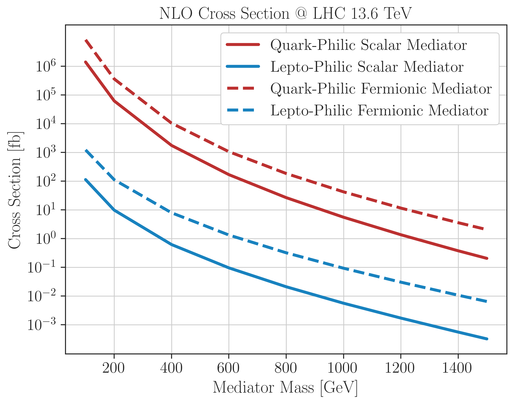

# tChannelDM Models

Repository to collect model definitions and files for event generation using t-channel DM simplified models.

## Models

The models are defined based on the spin and quantum numbers of the Mediator:

| UFO Model | Mediator Spin | Mediator Type | Mediator(s) | Couples to |
|---|---|---|---|---|
| [DMsimpt_Yfermion_leptons_NLO_UFO](FermionMediator/DMsimpt_Yfermion_leptons/DMsimpt_Yfermion_leptons_NLO_UFO) | 1/2 | Lepto-philic | $Y_F$ (charge $-1$, colour singlet) | $e_R,\ \mu_R,\ \tau_R$ | 
| [DMsimpt_Yfermion_quarks_NLO_UFO](FermionMediator/DMsimpt_Yfermion_quarks/DMsimpt_Yfermion_quarks_NLO_UFO) | 1/2 | Quark-philic | $Y_{Fu}$ (charge $+2/3$), $Y_{Fd}$ (charge $-1/3$), colour triplets | $u_R,c_R,t_R$ / $d_R,s_R,b_R$ | 
|||||||
| [DMsimpt_Yscalar_leptons_NLO_UFO](ScalarMediator/DMsimpt_Yscalar_leptons/DMsimpt_Yscalar_leptons_NLO_UFO) | 0 | Lepto-philic | $Y_{Se}$ (charge $-1$, colour singlet) | $e_R,\ \mu_R,\ \tau_R$ | 
| [DMsimpt_Yscalar_quarks_NLO_UFO](ScalarMediator/DMsimpt_Yscalar_quarks/DMsimpt_Yscalar_quarks_NLO_UFO) | 0 | Quark-philic | $Y_{Su}$ (charge $+2/3$), $Y_{Sd}$ (charge $-1/3$), colour triplets | $u_R,c_R,t_R$ / $d_R,s_R,b_R$ | 

**More information about each model can be found in the respective folders.**

## Cross Sections

The NLO cross-sections for each model as a function of the mediator mass is shown below:

 

    

the values can be reproduced using the in the [xsections branch](https://github.com/andlessa/tChannelDM_models/tree/xsections).

--------------------------------------
## References

### Papers:

* [LHC-friendly freeze-in model paper](https://arxiv.org/abs/1811.05478)

* [t-channel dark matter models – a whitepaper](https://arxiv.org/abs/2504.10597)

### FeynRules Model Database:

* [Simplified Freeze-in model](http://feynrules.irmp.ucl.ac.be/wiki/FICPLHC)

* [t-Channel DM Models database](http://feynrules.irmp.ucl.ac.be/wiki/DMsimpt)
